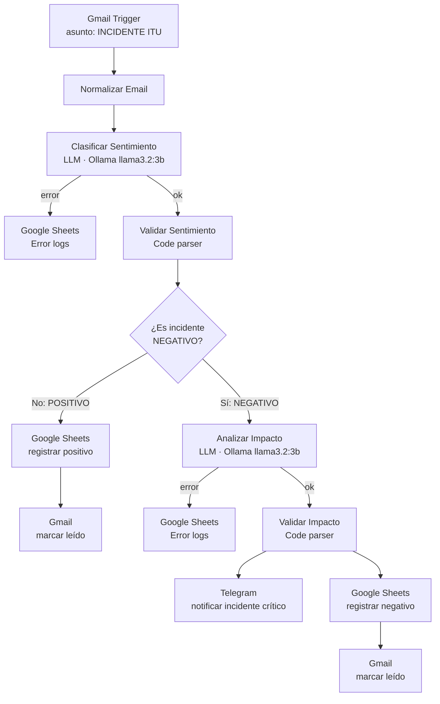

# Clasificador de Incidentes por Email con IA

Workflow de n8n que detecta incidentes técnicos reportados por Gmail, los clasifica y evalúa su impacto con un LLM local (Ollama), y notifica por Telegram — sin intervención manual.

## Diagrama de flujo



## Problema que resuelve

Los incidentes técnicos reportados por email suelen perderse en la bandeja de entrada o tardar en escalarse porque alguien tiene que leerlos, decidir si son relevantes y avisar al equipo. Este workflow automatiza esa primera triage: separa ruido de incidentes reales, estima la gravedad y avisa de inmediato solo cuando hace falta, dejando un registro auditable de todo lo que pasó (incluyendo lo que el LLM no pudo procesar).

## Cómo funciona

El workflow está compuesto por los siguientes nodos, en orden de ejecución:

1. **Trigger - Nuevos Incidentes ITU** (`gmailTrigger`) — hace polling cada minuto sobre Gmail filtrando por `subject: INCIDENTE ITU`.
2. **Normalizar Email** (`Set`) — extrae `id`, `subject`, `from` y `text` (snippet) del email crudo a un formato consistente para el resto del flujo.
3. **Clasificar Sentimiento** (`LangChain Agent` + **LLM - Sentimiento (Ollama)**, modelo `llama3.2:3b`) — clasifica el incidente como `POSITIVO` o `NEGATIVO` según un system prompt estricto que obliga a responder solo JSON en una línea (ver `prompts.txt`). Si el nodo falla, la ejecución continúa por la rama de error (`continueErrorOutput`) hacia **Error logs**.
4. **Validar Sentimiento (Parser)** (`Code`) — parsea el JSON devuelto por el LLM, valida que `sentiment` sea `POSITIVO` o `NEGATIVO` (`sentiment_ok`) y agrega `processed_at`.
5. **¿Es Incidente Negativo?** (`IF`) — bifurca el flujo:
   - **POSITIVO** → se registra directo en Google Sheets (**Agregar incidentes positivos a la tabla**) y se marca el email como leído (**Marcar mensaje leido positivo**).
   - **NEGATIVO** → pasa a análisis de impacto.
6. **Analizar Impacto** (`LangChain Agent` + **LLM - Impacto (Ollama)**, mismo modelo) — evalúa gravedad (`BAJO` / `MEDIO` / `ALTO`), genera un resumen (`summary`) y una acción sugerida (`action`). Tiene `retryOnFail` y, si falla, continúa hacia **Error logs1**.
7. **Validar Impacto (Parser)** (`Code`) — parsea la respuesta del LLM (tolerando markdown/fences), reinyecta el contexto original del email (id, subject, from, text) tomado de nodos anteriores, y valida que `impact_level` sea uno de los tres valores esperados.
8. **Notificar Incidente Crítico (Telegram)** — envía un mensaje con asunto, remitente, sentimiento, nivel de impacto, resumen y acción sugerida.
9. **Registrar Incidente Negativo (Sheets)** — guarda el resultado completo en la hoja de cálculo.
10. **Marcar mensaje leido negativo** (`Gmail`) — marca el email como leído para evitar reprocesarlo.

### Manejo de errores

Si el LLM devuelve un JSON inválido o el nodo de IA falla, la ejecución no se corta: ambos agentes (`Clasificar Sentimiento` y `Analizar Impacto`) tienen `onError: continueErrorOutput`, y cada rama de error escribe en una hoja separada de Google Sheets (**Error logs** / **Error logs1**) con timestamp y detalle del error.

## Setup

### Requisitos

- n8n (local o self-hosted)
- [Ollama](https://ollama.com/) corriendo con el modelo `llama3.2:3b`:
  ```bash
  ollama pull llama3.2:3b
  ```
- Credenciales configuradas **en el credential store de n8n** (no en el JSON):
  - Gmail OAuth2 (lectura + marcar como leído)
  - Google Sheets OAuth2 (registro de resultados y errores)
  - Telegram Bot (token + chat ID de destino)
  - Ollama API (host donde corre el modelo)

### Importar el workflow

1. En n8n: **Workflows → Import from File** y seleccionar `My workflow.json`.
2. Abrir cada nodo que requiere credenciales (Gmail, Google Sheets, Telegram, Ollama) y asignar/crear la credencial correspondiente — el JSON exportado solo trae el `id`/`name` de referencia, no valores.
3. Actualizar el `documentId` y `sheetName` de los nodos de Google Sheets para que apunten a tu propia planilla.
4. Ajustar el `chatId` del nodo de Telegram al chat/canal donde querés recibir las alertas.
5. Verificar que Ollama esté accesible desde n8n (mismo host/red) y que el modelo esté descargado.
6. Activar el workflow con el botón **Active**.

### Probar

1. Enviar un email con asunto `INCIDENTE ITU` a la cuenta de Gmail configurada, dejándolo sin leer.
2. Esperar al siguiente ciclo de polling (cada minuto).
3. Revisar la planilla de Google Sheets y, si el incidente fue clasificado como `NEGATIVO`, el chat de Telegram.

## Seguridad

- **Credenciales**: todas las integraciones (Gmail, Google Sheets, Telegram, Ollama) usan el **credential store de n8n** — el JSON exportado del workflow no contiene tokens, passwords ni API keys, solo el `id`/`name` de la credencial guardada en la instancia de n8n.
- **Ollama local**: el LLM corre en infraestructura propia, por lo que el contenido de los emails no sale hacia un proveedor externo de IA.
- **A validar en producción**:
  - El `chatId` de Telegram está hardcodeado en el nodo — en un entorno multi-tenant convendría moverlo a una variable de entorno de n8n.
  - El trigger de Gmail no valida el remitente del email, solo el asunto (`INCIDENTE ITU`); cualquiera que conozca ese asunto podría inyectar un "incidente" falso. Si el buzón no es privado, agregar una validación de dominio/remitente permitido antes de clasificar.
  - No hay rate limiting sobre el polling — si el volumen de incidentes creciera, evaluar mover el trigger a un webhook con verificación de origen en lugar de polling por asunto.

## Evidencia

Capturas del workflow funcionando en [`/evidencia`](./evidencia):

- [`CasoPositivo.jpeg`](./evidencia/CasoPositivo.jpeg) / [`GmailCasoPositivo.jpeg`](./evidencia/GmailCasoPositivo.jpeg) — ejecución de un incidente clasificado como POSITIVO.
- [`CasoNegativo.jpeg`](./evidencia/CasoNegativo.jpeg) / [`GmailCasoNegativo.jpeg`](./evidencia/GmailCasoNegativo.jpeg) — ejecución de un incidente clasificado como NEGATIVO, con análisis de impacto y notificación a Telegram.
- [`Incidentes guardados en un excel.jpg`](./evidencia/Incidentes%20guardados%20en%20un%20excel.jpg) — registro final en Google Sheets.

<!-- TODO: agregar captura del canvas completo del workflow en n8n (vista general de todos los nodos) -->

## Stack

- [n8n](https://n8n.io/) — orquestador
- [Ollama](https://ollama.com/) + `llama3.2:3b` — LLM local para clasificación y análisis de impacto
- Gmail OAuth2, Google Sheets OAuth2, Telegram Bot
